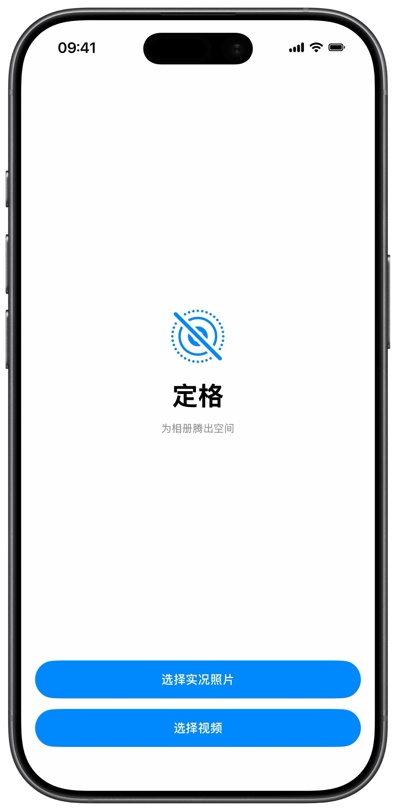
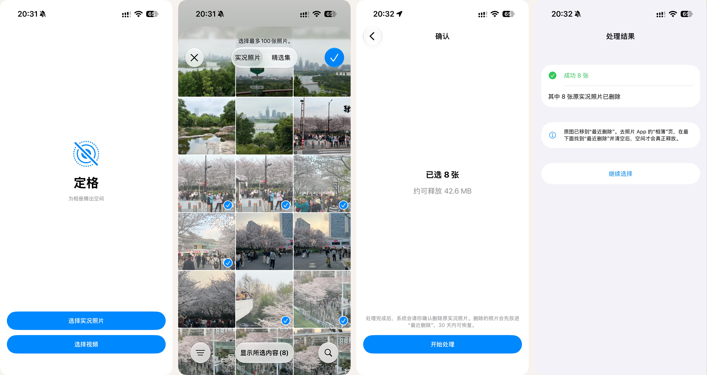
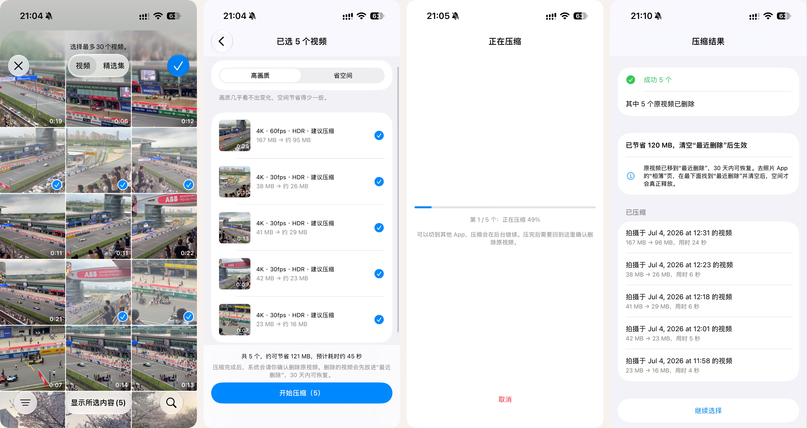

  

<h1 align="center">Unlive（定格）</h1>

为 iPhone 相册腾出空间

  

两个功能：

- **实况照片 → 静态照片**：无损转成静态照片，删掉视频部分。
- **压缩视频**：不改分辨率和帧率，只降低码率，生成新视频并删除原视频。4K60 视频大约能省一半空间。

两个功能都是"选一次就做完"：自动生成新文件、保留拍摄时间等信息，再一次性删除原件。

系统相册的"复制为静态照片"复制完后，选择就消失了，得回去把原图一张张重新挑出来删。定格把这件事一次做完。

## 为什么不用系统自带的方法

| | 系统"复制为静态照片" | 快捷指令 | 定格 |
|---|---|---|---|
| 挑选次数 | 两次（复制一次，删除再挑一次） | 一次 | 一次 |
| 画质和 EXIF | 无损 | 会重新压缩 | 无损（原样复制文件数据） |
| 相册归属、收藏 | 保留 | 丢失 | 保留 |
| 时间线位置 | 不变 | 可能变 | 不变 |

## 功能：实况照片 → 静态照片

- **一次选择**：弹出系统照片选择器，只显示实况照片，支持滑动多选（一次最多 100 张）
- **画质无损**：直接复制原始静态图的文件数据，不重新压缩，EXIF 等元数据完整保留
- **信息不丢**：拍摄时间、位置、收藏、隐藏状态和所在相册都会带到新照片上，时间线位置不变
- **先生成后删除**：新照片确认写入相册后才删除原图，只删转换成功的那些，系统只弹一次确认框
- **编辑过的照片**：按编辑后的样子生成，处理前会提醒"无法复原编辑"，可以选择跳过
- **iCloud 照片**：原图只在 iCloud 时会自动下载

  
   
  首页 → 选择实况照片 → 确认可释放空间 → 处理结果

## 功能：压缩视频

- **只降码率**：分辨率、帧率、每一帧的时间都不变，用手机的硬件 HEVC（10bit）编码；声音原样复制，不重新压缩
- **两档可选**："高画质"和"省空间"。码率本来就不高的视频会标"无需压缩"，默认不勾选
- **确认页一目了然**：每个视频显示规格（如"4K · 60fps"）、大小变化（如"1.4GB → 约 650MB"），底部汇总能省多少、预计多久
- **信息不丢**：拍摄时间（含时区）、位置、机型、镜头型号和焦距、收藏、隐藏状态、所在相簿都会带到新视频上；HDR、拍摄方向、音频混合等附加信息也一起保留，新视频在图库里的位置不变
- **先验证后删除**：每个新视频保存后都会检查能否正常读取、时长是否和原视频一致，通过的才删原视频，系统只弹一次确认框
- **稳定可靠**：开始前检查剩余空间；可以中途取消；iOS 26 起可以切到后台继续压缩；App 中途被关掉，下次打开会提醒处理没删完的原视频
- **iCloud 视频**：原视频只在 iCloud 时会自动下载

  
   
  选择视频 → 确认页（选画质、看能省多少）→ 正在压缩（可切到后台）→ 压缩结果

## 共同点

- **误点"不允许"也不怕**：系统删除确认框里点错了，结果页可以再删一次原件，或选择保留两份
- **不联网、不收集数据**：所有处理都在手机上完成

## 安装

还没有上架 App Store，需要用 Mac 上的 Xcode 自己编译安装：

1. 下载或克隆本仓库，用 Xcode 打开 `Unlive.xcodeproj`
2. 在项目设置的 "Signing & Capabilities" 里选择你自己的开发者账号（免费的 Apple ID 也可以），并把 Bundle Identifier 改成你自己的
3. 用数据线连接 iPhone，在 Xcode 顶部选择你的手机，按 `⌘R` 运行
4. 第一次安装需要在手机上打开"开发者模式"，并在"设置 → 通用 → VPN与设备管理"里信任你的开发者账号

> 用免费 Apple ID 安装的 App 大约 7 天后会失效，需要连接 Mac 重新运行一次。

## 系统要求

- iPhone，iOS 17 或更高版本（视频后台继续压缩需要 iOS 26）
- 需要相册的"完全访问"权限

## 已知限制

### 实况照片

- 一次最多处理 100 张：副本会先占用空间，原图删除后也要清空"最近删除"才会释放
- 编辑过的照片会按编辑后的样子生成，原图删除后无法再"复原"编辑
- 来自共享相簿或电脑同步的照片无法删除，会被跳过
- 无法区分"iCloud 共享图库"里的照片（系统没有提供识别方法）
- 删除的原图会先进入"最近删除"，需要手动清空才会真正释放空间

### 视频

- 一次最多处理 30 个：原视频要等全部压完才删除，压缩期间新视频会临时多占空间
- 压缩速度受手机编码硬件限制，4K60 视频大约要花和视频时长差不多的时间
- 杜比视界的动态信息会丢失，画面仍是 HDR（HLG）
- 电影效果、慢动作、空间视频不处理（会丢失后期调焦、变速和立体信息）
- 新视频刚生成时，图库里的缩略图可能和原视频不同（用第一帧）。照片 App 空闲时会重新分析，自动挑选画面
- 编辑过的视频按编辑后的样子压缩，原视频删除后无法再"复原"编辑
- iOS 26 以下的系统，压缩过程中需要停留在 App 里；iOS 26 起切到后台时，灵动岛和锁屏会显示进度（系统规定，无法关闭）
- 删除的原视频同样先进入"最近删除"，需要手动清空才会真正释放空间

## 文档

- [SPEC.md](SPEC.md)：功能说明和验收测试
- [Unlive 视频压缩功能 MVP.md](Unlive%20视频压缩功能%20MVP.md)：视频压缩功能的设计思路
- [问题记录.md](问题记录.md)：开发中遇到的问题、原因和解决办法
- [CLAUDE.md](CLAUDE.md)：开发协作规则

## 技术

SwiftUI + PhotoKit / PhotosUI + AVFoundation / VideoToolbox / BackgroundTasks，只用苹果系统框架，没有第三方库。

## 许可证

[MIT](LICENSE)
